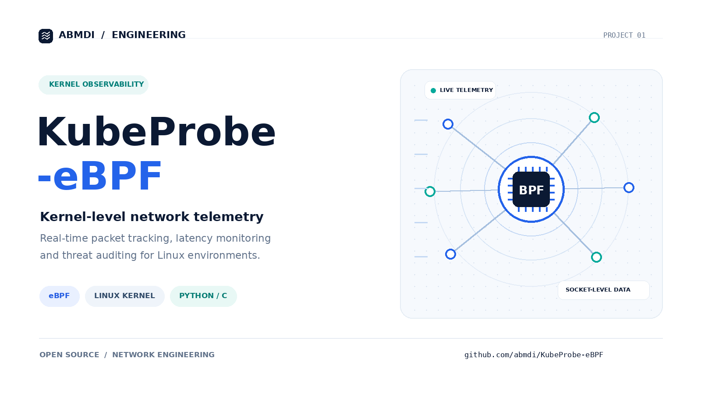

# KubeProbe-eBPF
Built custom eBPF probes in Python/C for real-time packet tracking, latency monitoring, and dynamic threat auditing directly at the Linux kernel level. Reduced diagnostic overhead for network bottlenecks by providing granular visibility into socket-level traffic.
